# Images and layers

An image is the recipe a container is made from. The container is what you get when you actually cook it.

## Recipe and cake

An **image** is read-only. It describes a filesystem (the program, its libraries, its settings) plus a note on which command to start. You can make as many **containers** from one image as you like, just as you can bake many cakes from one recipe. Each container gets its own private, writable layer on top, so they don't disturb each other.

## Names and tags

Images have names like `nginx:alpine` or `ghcr.io/owner/app:1.4`:

- `ghcr.io` is the **registry**: where the image is stored. Without one, Docker assumes Docker Hub.
- `owner/app` is the **repository**: the image's name.
- `1.4` is the **tag**: usually a version. Without a tag, Docker uses `latest`.

> **Tip:** pin tags in anything you care about. `latest` means "whatever was newest when you last downloaded", which quietly changes over time.

## Layers: why images are smaller than they look

Images are built in **layers**, stacked like transparent sheets. Each instruction in a `Dockerfile` adds one:

```dockerfile
FROM alpine:3.20              # layer 1: a tiny Linux
RUN apk add --no-cache curl   # layer 2: add a tool
COPY app /usr/local/bin/app   # layer 3: add your program
CMD ["app"]                   # metadata: what to run
```



Two images built `FROM alpine:3.20` **share** that bottom layer on disk. Ten containers of the same image share *all* of its layers. That is why a Raspberry Pi with a small SD card can still hold many of them.


```live images
In the dashboard this lists the biggest images on your own host.
```

## Useful commands

```sh
docker pull nginx:alpine           # download an image
docker images                      # list images on this machine
docker image prune                 # delete unused, untagged images
docker build -t myapp:1.0 .        # build an image from ./Dockerfile
```

In this dashboard, the **Images** page shows the same list, marks which images are in use, and can pull or clean up for you.

```quiz
Q: You run ten containers from the same image. How often are its layers stored on disk?
- [ ] Ten times, once per container
- [x] Once; each container only adds a thin writable layer
- [ ] Twice: one copy running, one as a backup
> Image layers are read-only and shared. Containers add only their own small writable layer on top, which is why images save so much space.
```

Next: [How Linux does it](under-the-hood.md).
