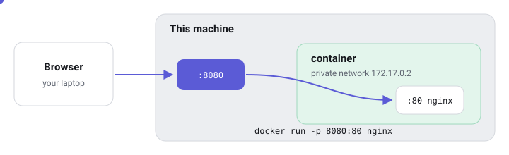

# Ports and networks

Each container has its own private network. To reach it from outside, you open a door: a published port.

## Publishing a port

A web server inside a container listens on *its* port 80. Nothing outside can reach it until you publish that port on the host:

```sh
docker run -d -p 8080:80 nginx:alpine
#               │    └── port inside the container
#               └─────── port on this machine
```

Read `-p 8080:80` as **"host 8080 leads to container 80"**. In the Containers tab, these appear as small blue pills like `8080→80`. Click one to open it.



> **Tip:** `-p 127.0.0.1:8080:80` publishes the port only to this machine itself, which is a good default for databases and admin tools.

## Container-to-container: user networks

Containers on the same **user-defined network** can find each other **by name**, because Docker runs a small DNS server for them:

```sh
docker network create shop
docker run -d --name db  --network shop -e POSTGRES_PASSWORD=secret postgres:16
docker run -d --name web --network shop -p 8080:80 my-web-app
# inside "web", the database is simply reachable at host name "db"
```

The database never needs a published port: only `web` talks to it, over the private network.

## The networks Docker creates for you

| Network | What it is for |
|---|---|
| `bridge` | The default. Private network with outbound internet access |
| `host` | No isolation: the container uses the host's network directly |
| `none` | No network at all |
| *your own* | Name-based discovery between the containers you attach |

Compose creates one private network per project automatically, which is why services in a compose file can reach each other by service name.

Next: [Keeping your data](keeping-data.md).
