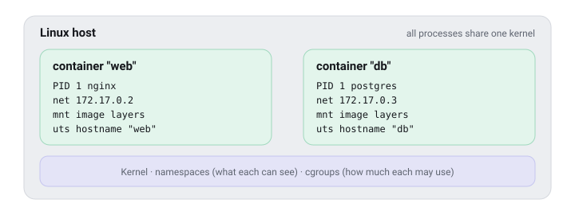

# How Linux does it

Containers are not magic, and not small virtual machines. They are ordinary Linux processes wearing three kinds of blinkers.

## 1. Namespaces: what a process can see

A **namespace** gives a process its own private view of one part of the system. A containerised process gets fresh namespaces for:

| Namespace | What the container sees |
|---|---|
| `pid` | Only its own processes; its main program believes it is process number 1 |
| `net` | Its own network card, IP address and ports |
| `mnt` | Its own filesystem, built from the image |
| `uts` | Its own hostname |
| `ipc` | Its own shared memory |
| `user` | Optionally, its own idea of who "root" is |



You can see the trick from the outside. Every container process is a normal process on the host:

```sh
docker run -d --name sleeper alpine sleep 600
ps -ef | grep "sleep 600"          # the host sees it like any other process
docker exec sleeper ps             # inside, it is PID 1 and alone
```

## 2. Control groups: how much it may use

**cgroups** limit and measure resources. They are where the CPU and memory numbers in this dashboard come from.

```sh
docker run -d --memory 128m --cpus 0.5 nginx:alpine
```

If a container exceeds its memory limit, the kernel stops it, and it exits with code **137**. The detail panel calls that "killed (out of memory or force-stopped)".

## 3. Overlay filesystems: the layers, stacked

The image layers from the previous lesson are glued together by **OverlayFS**: read-only layers at the bottom, one writable layer per container on top. Changing a file copies it up into the writable layer first ("copy-on-write"), so the image itself is never modified.

> **Why this matters:** because a container is just a process, starting one takes as long as starting the program itself. There is no operating system to boot. That is what makes containers practical on small machines.

```quiz
Q: A container keeps exiting with code 137. What is the most likely reason?
- [ ] The program wasn't found
- [x] It was killed: it ran out of memory, or someone force-stopped it
- [ ] It finished its work normally
> 137 = 128 + 9: the process received SIGKILL. With a memory limit, that's usually the kernel's out-of-memory killer. The dashboard's Incidents page records exactly these.
```

## Security in one paragraph

Namespaces separate containers well, but they all share **one kernel**. Treat a container like a separate user account, not a separate computer. And remember: whoever can talk to the Docker socket (`/var/run/docker.sock`) can start containers with full access to the host. That is effectively **root**, and it's why this dashboard asks for a password when it is reachable from the network.

Next: [Ports and networks](ports-and-networks.md).
