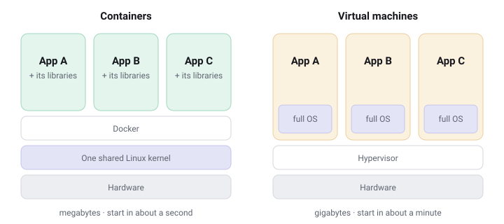

# What is a container?

A container is a program packed together with everything it needs to run, sealed so it behaves the same on every computer.

## The problem it solves

Every developer knows the sentence *"but it works on my machine"*. A program depends on many things around it: a specific version of a language, some libraries, configuration files, the right folders in the right places. Move the program to another computer and one of those things is almost always slightly different.

A container solves this by shipping the program **together with its surroundings**. Instead of installing an app and hoping the machine is set up right, you run a box that already contains the right setup.

## An everyday picture

Think of an apartment building.

- The **building** is your computer: one foundation, one water supply, one electricity line.
- Each **apartment** is a container: it has its own front door, its own furniture, its own lock. Neighbors can't walk into each other's living rooms.
- But apartments **share** the building's foundation and pipes, which is why you can fit many of them on one plot of land.

A **virtual machine**, by comparison, is like building a whole separate house for every family. Very private, but each one needs its own foundation, roof and plumbing.




```live containers
In the dashboard this shows the containers on your own host, right now.
```

## Why people love them

| | Container | Virtual machine |
|---|---|---|
| Starts in | about a second | about a minute |
| Size | megabytes | gigabytes |
| Runs on a Raspberry Pi | dozens at once | one or two, slowly |
| Isolation | strong | stronger |

> **In one sentence:** a container is a lightweight, sealed box around a program that runs the same everywhere, sharing the computer's core with its neighbors instead of bringing its own.

## Try it

If Docker is installed, this runs a tiny web server in a container and makes it reachable on port 8080 of this machine:

```sh
docker run -d --name hello -p 8080:80 nginx:alpine
```

It appears on the **Containers** page within a second. Open `http://<this-machine>:8080` to see it answer, then remove it again:

```sh
docker rm -f hello
```

```quiz
Q: What do containers on one machine share?
- [ ] Nothing; each one brings its own operating system
- [x] The operating system kernel, but not their files or processes
- [ ] Their files, so they can read each other's data
> Each container gets its own files, processes and network, but all of them run on one shared kernel. That's why they start in a second and fit dozens on a Pi.
```

Next, let's see what that `nginx:alpine` part means: [Images and layers](images.md).
